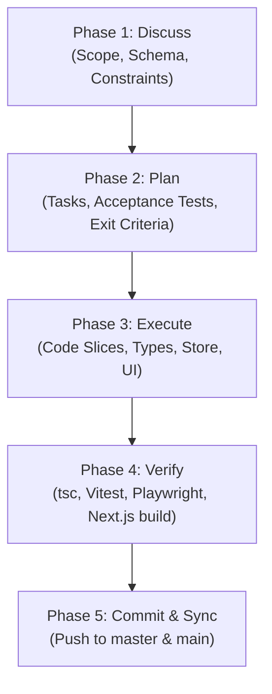

# GSD Workflow (Get Shit Done) — ReMatter AI

This skill enforces a disciplined, spec-driven development pattern for all engineering tasks in the ReMatter AI codebase. It prevents "context rot," ensures regressions are caught early, and protects production configuration.

---

## Core Operational Principles

1. **Inspect Before Modifying:** Always inspect the existing code, components, types, and database contracts before creating or changing files. Never guess APIs or write blind replacements.
2. **Atomic Slices:** Break every feature or enhancement into small, sequential, reviewable tasks. Never attempt large monolithic multi-file changes in a single step without intermediate validation.
3. **Preserve Working Architecture:** Strictly preserve existing Next.js routes, React 18 compatibility, Supabase authentication/policies, server-side API routes, environment variables, and Vercel deployment configurations.
4. **Design System Adherence:** All UI changes must adhere to the Mocha Brown (`#6F5148`, `#382923`), Platinum Silver (`#D5D6D8`, `#ECEBED`), and Pale Lavender (`#DCD6F7`, `#B9A9EE`) palette over the continuous Fluid Particles Background.
5. **No Blind Claims:** Never claim a test, build, or check passed unless the command was actually executed and exited with code `0`.
6. **Safety & Confirmation Gate:** Always obtain explicit user confirmation before:
   - Installing new dependencies or global packages.
   - Modifying environment secrets or database schemas.
   - Deleting or overwriting non-temporary files.
   - Triggering long-running autonomous background tasks.

---

## The 4-Phase Cycle

### Phase 1: Discuss
- Read `.gsd/ROADMAP.md` and `.gsd/STATE.md` to establish context.
- Identify exact requirements, user goals, and potential edge cases.
- Confirm any Supabase database schema requirements or third-party API rate limits.
- Document the scope in `.gsd/phases/XX-[feature]/01-discuss.md`.

### Phase 2: Plan
- Define clear **Acceptance Criteria** and test cases before writing code.
- Create an atomic task list in `.gsd/phases/XX-[feature]/02-plan.md`.
- Establish deterministic stopping conditions (e.g. `npm run typecheck`, unit tests, Playwright checks).
- Update `.gsd/STATE.md` to reflect the active phase.

### Phase 3: Execute
- Implement code changes incrementally in small, focused batches.
- Keep components typed, documented, and aligned with project conventions.
- Record modified files and decisions in `.gsd/phases/XX-[feature]/03-execute.md`.

### Phase 4: Verify
- Run `npm run typecheck` (`tsc --noEmit`) to verify strict type validity.
- Run `npm test` (`vitest run`) for unit and validation test suites.
- Run `npm run build` (`next build`) to ensure all static and dynamic routes compile.
- Run Playwright (`node scripts/test-[feature].js` or `playwright-cli`) for critical UI flows and responsive viewports (Desktop, Tablet, Mobile).
- Document actual test logs in `.gsd/phases/XX-[feature]/04-verify.md`.
- Update `.gsd/STATE.md` to mark the phase complete.
